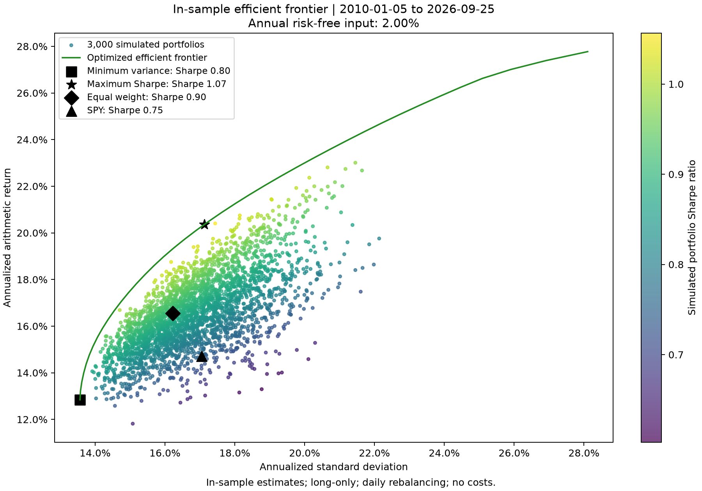
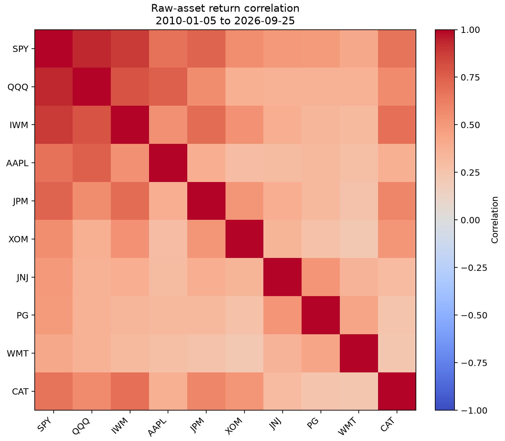
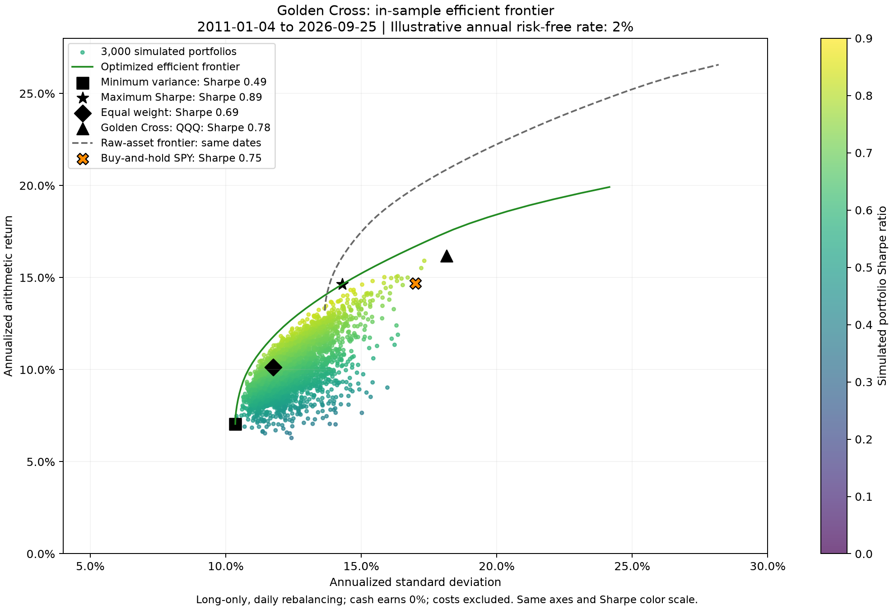
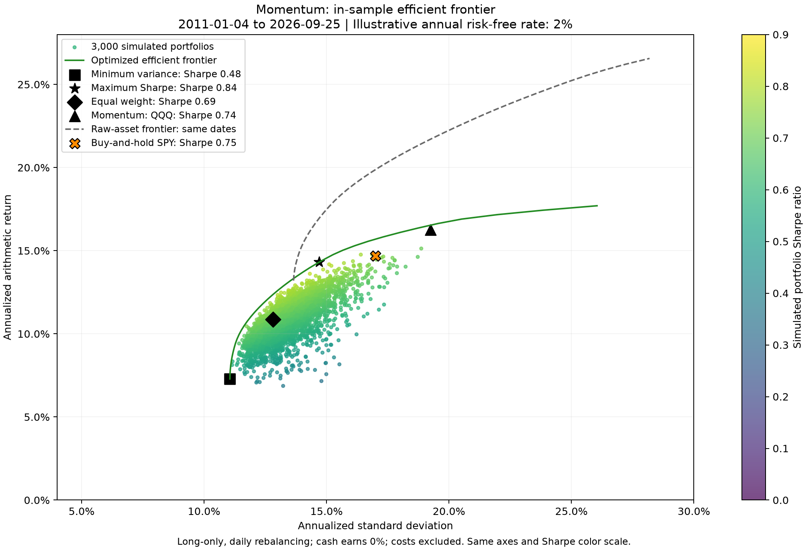
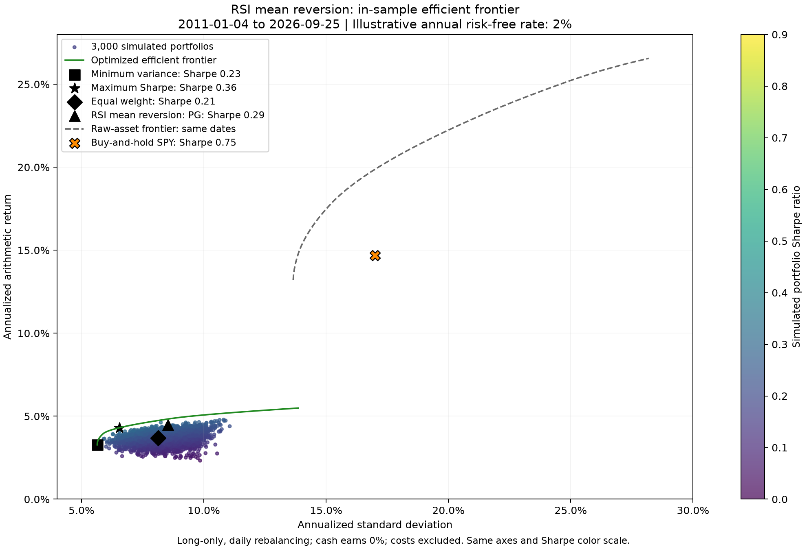
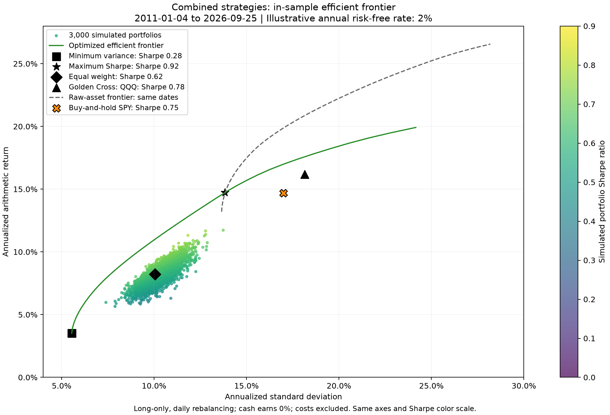
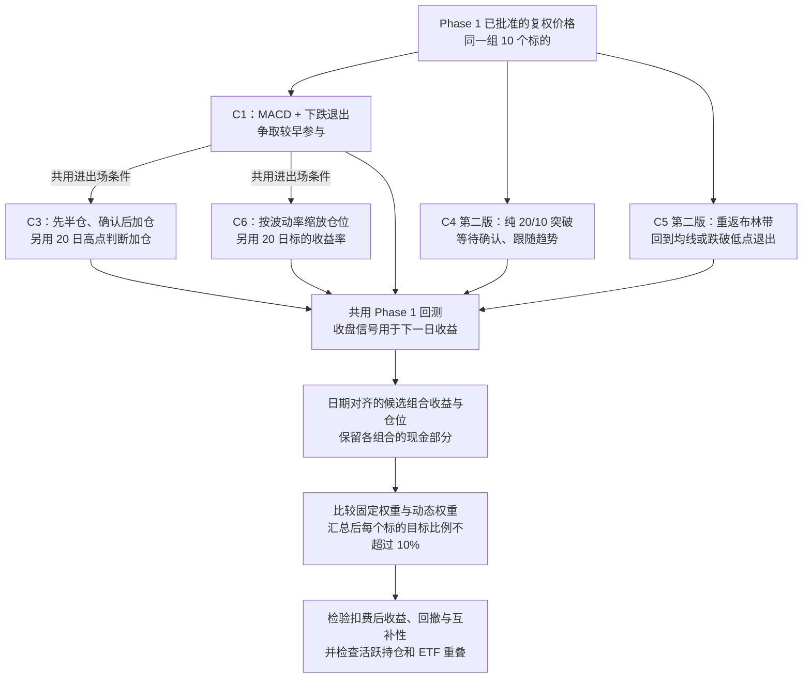

# backtesting_2_fa26_uiuc
Repository for Backtesting group 2 for Fall 2026 semester's Financial Engineering club projects.

The tickers being used for phase 1 are: SPY, QQQ, IWM, AAPL, JPM, XOM, JNJ, PG, WMT, CAT

Commit completed work to `Kevin-Mean-revision` and submit a pull request into `main`.

## Current work

This is a small, offline backtesting foundation with one entry point: `run.py`.
The command-line runner uses buy-and-hold, or raw-asset portfolios with `--phase2`.
RSI mean reversion and Huixin's strategies use the same Python workflow.
The [Phase 3 frontiers](#phase-3-strategy-frontiers) reuse these functions for
each strategy and for all 30 strategy–ticker return streams together.
A risk-free rate must be supplied explicitly; no rate is downloaded or assumed.
Completed coding work goes to `Kevin-Mean-revision`
and then through a pull request into `main`.

- `run.py` loads the data once, calls the calculations, and returns their results.
- `data.py` reads the approved dataset, verifies its raw-file checksum, compares
  adjusted prices with the raw observations, and checks the NYSE trading calendar.
- `backtest.py` applies supplied positions to the following day's returns and
  compares each ticker with buy-and-hold over the same dates.
- `metrics.py` calculates performance statistics from a daily return table.
- `mean_reversion.py` returns RSI-based signals independently of Golden Cross.
- `strategies.py` contains Huixin's Golden Cross and momentum rules.
- `compare.py` compares strategy metrics over a shared evaluation period.
- `portfolio.py` combines daily returns into portfolios and finds the frontier.
- `plots.py` draws equity curves, the correlation heatmap, and the frontier.
- `tests/test_core.py` checks these functions against existing local observations.

Each file keeps its role across phases. All source, tests, comments, and blank
lines combined must stay at or below 600 lines, with at most 300 added for Phase 2.
The earlier mean-reversion addition retains its separate 100-added-line limit.
All charts and their interpretations are presented in this README. The `docs/`
folder contains supporting PNG images only; there is no separate visual report.

## Run the current baseline

From the repository folder, use a Python environment with the libraries in
`requirements.txt` installed. For the existing local environment and dataset:

```sh
.venv/bin/python -B run.py data
```

The data-folder argument is required; replace `data` with the path to your approved
dataset when needed. The command prints a table of buy-and-hold results. It does
not create result files. Use `--help` for the options. An explicit annual decimal
rate can be supplied with `--risk-free`; otherwise Sharpe remains unavailable.

## Run RSI mean reversion

From the repository folder, explicitly select this strategy using the same local data:

```sh
.venv/bin/python -B - <<'PY'
from mean_reversion import mean_reversion
from run import analyze
result = analyze("data", strategy=mean_reversion)
print(result["summary"].to_string())
print(result["benchmark_summary"].to_string())
PY
```

### How to read the strategy

`mean_reversion` keeps three steps together: check the settings, prepare daily
gains and losses, then update RSI and each ticker's position one day at a time.
It takes a price table, with dates in rows and tickers in columns, and returns
a decision table with the same layout. `1.0` means invested, `0.0` means cash,
and `NaN` means there is not enough history to make a decision yet.

RSI (Relative Strength Index) compares recent gains with losses. The default
uses 14 daily price changes, so the first value needs 15 price observations.
Wilder's smoothing starts with the average of those gains and losses; afterward,
each average becomes (13 times its previous value + today's gain or loss) / 14.
Losses are measured as positive amounts. RSI is 100 times the average gain divided
by the sum of the average gain and average loss. All gains gives RSI 100 and all
losses gives 0. When both smoothed averages are zero, this implementation uses
neutral RSI 50; a single flat day does not reset an existing RSI to 50.

| RSI after warm-up | Decision for each ticker |
|---|---|
| Below 30 | Buy if currently in cash; otherwise remain invested |
| From 30 up to, but not including, 50 | Keep the current position: invested or cash |
| 50 or higher | Sell if invested; otherwise remain in cash |

The mean-reversion idea is to test whether a rebound follows recent weakness.
This is a hypothesis, not a guarantee that a low-RSI asset will recover. Holdings
are tracked separately for each ticker; these are not weights in a combined portfolio.

Decisions are made at the close. The shared backtest applies each decision to the
following close-to-close return, so today's price is not used to choose today's
position. With the default period, the first 14 decision rows stay missing;
the first decision is at observation 15 and evaluation starts at observation 16.
The benchmark uses those same evaluation dates. At least 17 price observations
are needed for the backtest's minimum of two evaluation returns.

The function only calculates signals from its input; it does not download, change,
or save data. It does not depend on Huixin's strategy file. Both strategies can
use the shared backtest and metrics independently. Costs and cash interest remain
zero. Without an explicit risk-free input, Sharpe stays unavailable.

## How the phases connect

`analyze(data_folder, strategy=None, risk_free=None)` in `run.py` is the shared
workflow. It returns an ordinary dictionary of tables, so later phases can reuse
the same objects without saving or reloading intermediate files.

| Result | What it contains |
|---|---|
| `prices` | Complete validated history, including dates needed for warm-up |
| `held_positions` | Prior-day decisions applied to the evaluation dates |
| `asset_returns` | Raw buy-and-hold asset returns over the evaluation dates |
| `strategy_returns` | Returns earned by the supplied signals, on matching dates |
| `benchmark_returns` | A separate copy of the matching buy-and-hold returns |
| `equity`, `benchmark_equity` | Growth from one, including the initial close |
| `summary`, `benchmark_summary` | Matching performance-statistic tables |
| `benchmark_only` | True when no strategy function was supplied |

Each strategy function takes `prices` and returns a signal
table with the same dates and columns. Passing that function to `analyze` uses the
existing backtest and metrics. Without it, both return tables contain the baseline;
`benchmark_only=True` means no selected strategy has been evaluated.

Phase 2 passes the baseline's `asset_returns` to `analyze_portfolios` in
`portfolio.py`. Do not pass a strategy backtest's shortened warm-up window when
you intend to use the full raw-asset history. Phase 3 instead supplies aligned
`strategy_returns`, with each column named by strategy and ticker. The optimizer's
internal comparison is one of those streams; raw SPY is compared separately.
Both phases can use `summarize` with portfolio names as columns and `equity_curve`
for growth calculations. The matched evaluation dates make comparisons fair;
`prices` retains the full history when an explicitly different period is required.

The Phase 3 analysis below uses the existing Python functions. The CLI's
`--phase2` option continues to analyze raw assets. A benchmark-only result does
not contain a selected strategy's returns.

## Run Phase 2

### Sharpe ratio graph



Updated on October 24, 2026 using the approved January 5, 2010–September 25, 2026
return sample and an illustrative 2% annual risk-free rate. Point colors show
simulated portfolio Sharpe ratios; black markers identify the four comparisons.
The axes show risk and return, not Sharpe. This is a saved snapshot, updated only
on request, not a live chart.

The maximum estimated Sharpe is **1.073**, compared with **0.898** for equal
weights and **0.747** for SPY. These are historical estimates, not forecasts or
a universal ceiling. The graph correction does not improve investment returns.

| Portfolio | Arithmetic return/year | Volatility/year | Sharpe |
|---|---:|---:|---:|
| Minimum variance | 12.84% | 13.57% | 0.801 |
| Maximum Sharpe | 20.36% | 17.13% | 1.073 |
| Equal weight | 16.55% | 16.22% | 0.898 |
| SPY | 14.72% | 17.05% | 0.747 |

Equal weight holds 10% in each asset; SPY is the single-index comparison.
Each dot is one of 3,000 allocations; its color measures Sharpe. The green line
comes from constrained optimization, not from joining the best random dots.
It traces the upper frontier, starting at the minimum-variance portfolio.
Within this mean–variance model, a risk-averse investor prefers the frontier:
least variance for a target return, or highest return for a given risk. The chosen
point depends on risk tolerance. Maximum Sharpe does not mean minimum risk.
See [CFA Institute's portfolio risk and return explanation](https://www.cfainstitute.org/insights/professional-learning/refresher-readings/2026/portfolio-risk-return-part-1).

### Correlation and diversification



The heatmap uses the same **4,207 daily returns** as the frontier. Correlation
near 1 means returns tend to move together. The checks below exclude self-pairs
and count each distinct pair once; "least" means the smallest signed value.

| Correlation check | Result |
|---|---:|
| Highest pair: SPY / QQQ | 0.930 |
| Second-highest pair: SPY / IWM | 0.882 |
| Lowest pair: XOM / WMT | 0.213 |
| Median of the 45 distinct pairs | 0.390 |
| Pairs above 0.80 | 2 / 45 |
| Negative pairs | 0 / 45 |

The 0.80 level is a descriptive flag, not an exclusion rule. Shared U.S. equity
exposure may explain the highly correlated ETF pairs; different business drivers
may help explain XOM/WMT. These are interpretations, not causal findings, and
correlations can change with the period.

Lower correlations help all else equal; negative correlation is not required.
Returns, individual volatilities, and weights also determine portfolio risk.
For the maximum-Sharpe weights, the weighted average individual volatility is
23.89%, while portfolio volatility is 17.13%. Their ratio is **1.395**.
The former is the hypothetical volatility if every pair had correlation +1,
with weights and individual volatilities unchanged. This is a mathematical
comparison, not another observed portfolio or a forecast.

Perfectly positively correlated assets offer no correlation-based diversification
benefit. They can still be held together: identical return streams can share a
weight without changing portfolio results. Lower volatility also does not
guarantee smaller drawdowns or better future returns.

### Why 1.07 is not just an ETF-overlap problem

| Asset | Maximum-Sharpe weight |
|---|---:|
| AAPL | 36.29% |
| JNJ | 23.36% |
| WMT | 23.32% |
| CAT | 15.81% |
| JPM | 1.06% |
| QQQ | 0.17% |
| SPY | 0.00% |
| IWM | 0.00% |
| XOM | 0.00% |
| PG | 0.00% |

Weights are rounded; tiny numerical residuals appear as zero. The optimizer
already assigns almost no weight to the index ETFs. The top three allocations
total **82.96%**, so the portfolio remains concentrated.

Because zero weights are allowed, removing an asset cannot increase the
theoretical best in-sample Sharpe: it only narrows the available choices.
The maximum depends on estimated returns and covariances, the sample, the
risk-free input, and the long-only constraints. A matched comparison is more
informative than calling 1.07 "good" or "not great" on its own.

### Proposed basket for review

**Proposal only: no tickers changed, new prices downloaded, or candidate results
calculated.** Keep ten assets and the SPY benchmark. Retain SPY and the seven
individual stocks; replace QQQ and IWM with two different asset exposures:

| Proposed change | Reason to test it | Limitation |
|---|---|---|
| QQQ → IEF | Add U.S. Treasury bonds with 7–10 years to maturity | Bond prices can fall when yields rise; lower equity correlation must be measured |
| IWM → IAU | Add exposure to physical gold through a gold trust | Gold can be volatile; negative equity correlation is not assumed |

These exposure descriptions come from [iShares IEF](https://www.ishares.com/us/products/239456/ishares-7-10-year-treasury-bond-etf)
and [iShares IAU](https://www.ishares.com/us/products/239561/ishares-gold-trust).
The diversification benefit is a hypothesis to test, not a result supplied by
those sources. Both products launched before 2010; complete approved price
coverage still needs checking.

Proposed order: **SPY, IEF, IAU, AAPL, JPM, XOM, JNJ, PG, WMT, CAT**.
This changes the original equity-only universe and removes QQQ/IWM exposures.
Replacing assets does not guarantee a higher Sharpe. The proposal aims to test
different return drivers, rather than selecting assets to force a higher result.

After approval of the basket and its data, compare it with the original basket
using the same dates, 2% illustrative rate, 252-day annualization, and long-only
weights. Reuse the Phase 1 cleaning and return definitions; keep the original
approved dataset intact. Check complete aligned observations and weights summing
to one within `1e-8`. Report changes in maximum Sharpe, minimum volatility,
volatility at matched feasible returns, pair correlations, and the largest weight.
Keep equal-weight and SPY comparisons, and report deterioration as well as gains.
Any data acquisition or saved output needs an explicit request; this proposal
does not add a download or export step to the code.

### Run the analysis

Use the same environment and approved data folder. This command explicitly asks
for calculations and two chart windows; it does not save them:

```sh
.venv/bin/python -B run.py data --phase2 --risk-free 0.02
```

Here, `0.02` is the user-approved 2% illustration, not an observed Treasury or SOFR
rate. Replace it only when a different rate is selected. A historical-period average Treasury
yield can be used as a constant proxy, but must be obtained and selected explicitly.
Phase 2 rejects a missing rate. It supports a constant rate so the optimizer's
Sharpe definition matches Phase 1; it does not accept a time-varying rate series.

The runner first calls the existing baseline, then passes its raw-asset returns
to `analyze_portfolios`. There are no strategy signals or warm-up losses in this
Phase 2 sample. Every asset and comparison uses exactly the same dates.

| Returned table | Rows and columns |
|---|---|
| `asset_summary` | Ten assets × existing metrics plus `expected_return` |
| `correlation`, `covariance` | Ten assets × ten assets, in the original ticker order |
| `correlation_pairs` | Least and most correlated distinct pairs, in that order |
| `simulation_weights`, `simulation` | 3,000 portfolios × asset weights or three statistics |
| `frontier_weights`, `frontier` | 40 optimized points × weights or statistics |
| `comparison_weights`, `comparison` | Four named portfolios × weights or statistics |
| `comparison_returns` | Original return dates × four named portfolios |
| `comparison_summary` | Four portfolios × existing metrics plus `expected_return` |

The three statistics are arithmetic expected return, annualized volatility, and
Sharpe. `period` and `risk_free` keep the dates and rate input with the result.
Weights are nonnegative and sum to one. The random seed is 42, so rerunning the
same inputs produces the same 3,000 simulated allocations. These are alternative
weights applied to existing returns, not generated market observations.

### Calculations and limits

Expected return is the daily arithmetic mean multiplied by 252. The existing
`annualized_return` remains CAGR (compounded annual growth); it is reported in
the summary but is not used as the frontier's vertical coordinate.
`numpy.cov(..., rowvar=False, ddof=1) * 252` estimates annual sample covariance:
columns represent assets and off-diagonal entries describe their joint movement.
Portfolio variance is `weights @ covariance @ weights`; its square root is volatility.
See [NumPy's covariance documentation](https://numpy.org/doc/stable/reference/generated/numpy.cov.html).

The same Phase 1 risk-free conversion is used throughout: a constant annual rate
becomes `(1 + rate) ** (1 / 252) - 1` per trading day. Sharpe is the annualized daily
excess mean divided by annualized volatility. With a constant rate, excess-return
volatility equals raw-return volatility. No cash interest is added to strategies.
The optimizer requires positive portfolio risk and at least one positive expected
excess return; otherwise it stops rather than presenting an undefined tangency.
Solver failures and constraint violations also stop the analysis. The solver uses
[SciPy SLSQP](https://docs.scipy.org/doc/scipy/reference/optimize.minimize-slsqp.html).

Fixed portfolio weights imply daily rebalancing, unlike letting initial asset
weights drift. Costs are excluded. Weights are fitted and evaluated on the same
history, so these are in-sample estimates, not an out-of-sample trading result.
The chosen stocks also represent a selected surviving universe; this exercise
does not establish how an investor would have selected them at the start of 2010.
`plot_portfolios` returns two figures in memory; only the explicitly invoked CLI
shows them. Nothing exports files or refreshes data automatically.

All numerical evidence above comes from the approved local inputs through
[run.py](run.py), [portfolio.py](portfolio.py), and [metrics.py](metrics.py).
The two PNG snapshots were saved on explicit request. The
[existing-data caveats](#existing-data) also apply to every displayed result.

## Phase 3: strategy frontiers

Updated October 26, 2026. Each strategy–ticker return stream is treated as an
investable component. The first three frontiers each combine ten tickers using
one strategy; the fourth combines all **30 streams**. A weight assigns capital
to that strategy account, including its cash days. The existing trading rules
and the ten approved tickers are unchanged.

The [five proposed combinations](#proposed-strategy-combinations) below describe
the next experiments. They are not implemented or included in these frontier results.

All four analyses use **3,955 daily returns, January 4, 2011–September 25, 2026**,
and the approved **2% illustrative annual risk-free rate**. Signals are calculated
from the full Phase 1 price history. Returns are aligned after the longest
warm-up; the existing backtest applies the one-day execution delay once.
Cash returns remain zero, and no missing observations are filled.

### Read the four charts

Each chart shows 3,000 simulated allocations and 40 optimized upper-frontier
points. The green line belongs to the named strategy universe. The dashed gray
line is the raw-asset frontier recalculated on the same dates; the orange X is
buy-and-hold SPY, an external comparison that receives no strategy-portfolio
allocation. All charts share their axes and Sharpe color scale.

Black markers identify minimum variance, maximum Sharpe, equal weights, and the
single stream with the highest estimated Sharpe in that universe. "Best" is
selected using this same historical sample, not information available in 2011.
Annual returns below are arithmetic means multiplied by 252, not CAGR.

| Maximum-Sharpe portfolio | Annual return | Annual volatility | Sharpe |
|---|---:|---:|---:|
| Golden Cross: ten streams | 14.63% | 14.29% | 0.885 |
| Momentum: ten streams | 14.31% | 14.70% | 0.839 |
| RSI mean reversion: ten streams | 4.31% | 6.55% | 0.355 |
| Combined: 30 streams | 14.73% | 13.84% | **0.921** |
| Raw assets: matching dates | 19.20% | 16.31% | **1.056** |
| Buy-and-hold SPY: matching dates | 14.70% | 17.00% | 0.748 |

The original Phase 2 maximum of 1.073 uses a longer sample. **1.056 is the
appropriate raw-asset comparison here.** Combining strategies improves the
estimated maximum over each strategy alone, but does not beat the matched-date
raw-asset maximum. These estimates do not establish future outperformance.

| Universe | Minimum volatility | Minimum-variance Sharpe | Equal-weight Sharpe | Best single stream: Sharpe |
|---|---:|---:|---:|---|
| Golden Cross | 10.35% | 0.490 | 0.693 | Golden Cross QQQ: 0.782 |
| Momentum | 11.05% | 0.480 | 0.694 | Momentum QQQ: 0.742 |
| RSI mean reversion | 5.64% | 0.230 | 0.209 | RSI PG: 0.292 |
| Combined | 5.55% | 0.277 | 0.621 | Golden Cross QQQ: 0.782 |

### Golden Cross frontier



This combines the existing 50/200-day trend rule across tickers. Its maximum
Sharpe exceeds the best single stream's 0.782 and equal weights' 0.693 in this
sample. The maximum-Sharpe allocation uses five tickers; it is still exposed
to shared equity trends and delayed exits after reversals.

### Momentum frontier



This uses each ticker's positive return from 252 sessions ago to 21 sessions
ago. It does not rank assets to select relative winners. Its maximum Sharpe is
below Golden Cross on these dates. These two trend rules can hold the same
underlying stocks at the same time, so their names alone do not imply independence.

### RSI mean-reversion frontier



This uses 14-day RSI, entering below 30 and exiting at or above 50. The fitted
portfolio has low volatility and low return. Its maximum-Sharpe weights average
only **9.79% invested in equities** across days; the remainder is zero-interest
cash inside the strategy accounts. Low volatility therefore should not be read
as evidence of better diversification by itself. For comparison, the corresponding
equity exposure is 78.30% for Golden Cross and 83.58% for momentum.

### Combined strategy frontier



All 30 streams are eligible, with nonnegative weights summing to one. Zero
weights let the combined universe reproduce any separate strategy portfolio,
so its theoretical best in-sample Sharpe cannot be lower. The fitted maximum
uses six streams: about **69.81% Golden Cross and 30.19% momentum**. RSI receives
zero weight at this particular maximum-Sharpe point; that does not exclude it
from lower-risk points on the frontier or prove it will be unhelpful in another
period. The combined minimum volatility is 5.55%.

### Maximum-Sharpe allocations

For the separate frontiers, each percentage is capital allocated to that
strategy on the named ticker. Zeros include tiny solver residuals; rounding
may prevent displayed weights from totaling exactly 100%.

| Ticker | Golden Cross | Momentum | RSI mean reversion |
|---|---:|---:|---:|
| SPY | 0.00% | 0.00% | 0.00% |
| QQQ | 34.29% | 37.72% | 8.67% |
| IWM | 0.00% | 0.00% | 0.00% |
| AAPL | 26.30% | 10.63% | 4.85% |
| JPM | 11.36% | 6.13% | 13.96% |
| XOM | 14.19% | 3.73% | 0.00% |
| JNJ | 0.00% | 0.00% | 0.00% |
| PG | 0.00% | 0.00% | 41.12% |
| WMT | 13.87% | 31.26% | 29.72% |
| CAT | 0.00% | 10.52% | 1.68% |

| Combined stream | Weight |
|---|---:|
| Golden Cross: QQQ | 26.99% |
| Golden Cross: AAPL | 23.53% |
| Golden Cross: JPM | 8.14% |
| Golden Cross: XOM | 11.14% |
| Momentum: WMT | 23.92% |
| Momentum: CAT | 6.27% |
| Other 24 streams | 0.00% |

### Shared data and reproduction

The saved analysis uses the existing functions; no second backtest or portfolio
engine was added. Follow these steps with the approved local dataset:

1. Load full prices with `data.load_prices`. For each of `golden_cross`,
   `momentum`, and `mean_reversion`, pass its signals to `backtest` and keep
   `strategy_returns`.
2. Give columns unique strategy/ticker names. Join the three tables on their
   common dates, preserving cash zeros. Here the separate tables are 3,955 × 10
   and the combined table is 3,955 × 30. Do not shift these returns again.
3. For each table, use `summarize(table, 0.02)` to identify its highest-Sharpe
   single column. Pass that column's name as `benchmark` to
   `analyze_portfolios(table, 0.02, benchmark=...)`. This internal comparison is
   a strategy stream, not raw SPY. The function returns simulations, the frontier,
   comparison metrics, and their full allocation tables in memory.
4. Recalculate raw-asset returns on those same dates for the gray reference
   frontier and raw-SPY comparison. Keep them outside the strategy input table.
5. Call `plot_portfolios(result, label=...)` with the strategy name. It returns
   figures without saving. These four PNGs were explicitly exported for this
   request; the export also adds the external references and common scales.

The same `numpy.cov(..., rowvar=False, ddof=1) * 252` and risk-free conversion
apply in every case. Portfolio weights are fixed targets rebalanced daily;
the underlying strategy positions still switch between invested and cash.
Costs and slippage are excluded. This is a static, in-sample frontier analysis;
it does not implement dynamic portfolio weights or mix raw assets into the
strategy portfolios. The proposed IEF/IAU substitutions remain unimplemented.

Checks: all frontier weights sum to one and meet their target returns within
`1e-8`; comparison metrics agree with directly weighted daily returns. An
independent convex reformulation reproduced each maximum Sharpe within `1e-8`.
These checks validate the calculations, not future performance. The existing
data-quality and selected-universe limitations below still apply.

### Proposed strategy combinations

The retained shortlist is **C1, C3, C4, C5, and C6**. C4 replaces C2, whose MACD
account could remain invested below the 10-day low. The labels preserve the earlier
discussion; C6 remains part of the research shortlist.

These five research proposals aim for practical trading and returns after costs,
with acceptable volatility and drawdown. They target quicker participation in
rebounds and quicker exposure reduction during continued declines. Their response
speed, returns, and diversification have not been tested; no new results are claimed.

All five use the same ten approved tickers: **SPY, QQQ, IWM, AAPL, JPM, XOM,
JNJ, PG, WMT, and CAT**. Each ticker has a maximum target allocation of **10% of
total portfolio equity**, including all strategy accounts for that ticker.
Unused allocations stay in cash and are not redistributed to the remaining
active tickers. Positions are long-only, with no leverage. Decisions use completed
daily observations and take effect on the following day's return, as in Phase 1.

MACD is the 12-day exponential moving average minus the 26-day exponential moving
average. An exponential average gives more weight to recent observations. The
signal line is a 9-day exponential average of MACD. Here, "bullish MACD" means
MACD is above its signal line; equality or a lower value means the condition is off.

The channel thresholds are the highest adjusted close in the previous 20 trading
days and the lowest adjusted close in the previous 10 trading days. Both exclude
today's close and are recalculated daily. This is a closing-price variation of
Donchian channels. Signals begin only after sufficient history is available.

#### C1. MACD entry with an additional downside exit

For each ticker, invest its **10% budget** while MACD is bullish and the adjusted
close is at or above the previous 10-day lowest close. Otherwise hold that budget
in cash. Re-enter when both conditions recover; a new 20-day high is not required.

This provides two ways to reduce exposure: weakening MACD or a downside breakdown.
It is the closest design match to the response goal, but bullish MACD can occur
while prices are still falling. Repeated exits and re-entries can increase costs.

#### C3. Enter partially, increase after confirmation

For each ticker, use these target allocations:

1. From cash, invest **5% of portfolio equity** when C1's entry conditions hold.
2. Increase to **10%** when the close exceeds the previous 20-day highest close.
   If this also happens on the entry day, the target can immediately be 10%.
3. After increasing, retain 10% until MACD is no longer bullish or the close falls
   below the previous 10-day lowest close. Either condition exits the entire
   position, including a position still at 5%. The exit condition takes priority.
4. After an exit, start again from the entry rule; do not keep the previous full-position state.

This permits partial participation before breakout confirmation. However, some
rebound gains may occur while half the budget remains in cash. Tracking the
partial and full positions also requires more logic and testing.

#### C4. MACD and breakout with a shared downside exit

For each ticker, assign **7% of portfolio equity to C1's rule and 3% to breakout**.
The first account invests only when MACD is bullish and price is at or above the
previous 10-day lowest close. The breakout account enters above the previous
20-day highest close, holds until price falls below the previous 10-day lowest
close, and otherwise keeps its existing position. Start that account in cash.

The accounts act independently, giving target exposures of 0%, 3%, 7%, or 10%.
Both exit after a downside breakdown, including when MACD remains bullish.
This removes C2's remaining 7% exposure in that situation. False breakdowns can
still cause costly exits and re-entries; the breakout account can enter rebounds late.

#### C5. Full entry with partial exposure during weakness

Run the same breakout account state as C4 independently, then set one target
allocation per ticker, using this order:

1. Invest **10%** when C1's entry conditions hold.
2. Otherwise invest **5%** when the breakout account is active.
3. Otherwise hold cash. Below the previous 10-day lowest close, the target is **0%**.

These are alternative allocations, not amounts to add together. C5 can enter fully
before an upside breakout and retain half exposure when MACD weakens while the
breakout remains active. That can help during a temporary interruption, but the
remaining 5% can lose money before the downside channel breaks. Full early entry
also exposes more capital to a failed rebound than C3's partial entry.

#### C6. C1 with volatility-based position sizing

Use C1's entry and exit conditions. At each close, estimate annualized volatility
from the latest **20 completed daily raw-asset returns**, calculated from approved
adjusted prices: sample standard deviation multiplied by the square root of 252.
Wait for all required price and return history before taking a position.

When C1 is active, use **10%** if estimated volatility is at most **20%**, including
zero. Above 20%, use **10% times 20% divided by estimated volatility**. For example,
40% estimated volatility gives a 5% target, and 60% gives about 3.33%. When C1 is
inactive, hold cash. Apply the completed day's sizing decision to subsequent returns.

The 20% reference is an illustrative sizing choice, not a promised portfolio
volatility level. Use the underlying asset's returns so cash days do not make the
market appear artificially calm. C6 changes exposure, not entry/exit timing;
high volatility after a fall may reduce participation in a sharp rebound.
Research motivates investigating volatility management, but does not validate
this particular rule: [Moreira and Muir](https://amoreira2.github.io/alan-moreira.github.io/VolPortfolios_published.pdf).

All five are unimplemented combinations using the listed indicators. None changes
the existing Golden Cross, momentum, or RSI rules, and none appears in the four
frontier charts above.

Ten capped budgets spread capital across the approved universe, but the ETFs
overlap individual stocks and all positions remain US equities or cash. Active
holdings can shrink when signals switch off. The 10% limit is a ticker limit,
not a limit on a company's total exposure through direct holdings and ETFs.

#### How the combinations may complement each other

Their advantages can partly offset their limitations, but cannot cancel them.

| Candidate | Contribution to test | Trade-off that remains |
|---|---|---|
| C1 | Full participation before breakout confirmation can offset C3/C6's smaller early exposure | Greater loss if that early entry fails |
| C3 | Partial entry limits the amount exposed before confirmation | Less participation in a genuine early rebound |
| C4 | Retains a small breakout account through MACD weakness, with a shared downside exit | Breakout delay and losses before the downside threshold is crossed |
| C5 | More participation than C4 during early recovery or temporary MACD weakness | More capital exposed if weakness continues |
| C6 | Scales down exposure when recent volatility is high | Can remain lightly invested during a volatile rebound |

For an arithmetic illustration, give **20% to each candidate portfolio**. The
following targets apply to one ticker at that equal-weight allocation, assuming
C6's estimated volatility is **40%**. They are not backtest results; monthly
account weights would drift between rebalances.

| Signal state | C1 | C3 | C4 | C5 | C6 | Equal-weight blend |
|---|---:|---:|---:|---:|---:|---:|
| Fresh C1 entry; no breakout; C3 still partial | 10% | 5% | 7% | 10% | 5% | **7.4%** |
| Bullish MACD and confirmed breakout; C3 fully invested | 10% | 10% | 10% | 10% | 5% | **9.0%** |
| MACD off; existing breakout remains active above its exit | 0% | 0% | 3% | 5% | 0% | **1.6%** |
| Price below the previous 10-day lowest close | 0% | 0% | 0% | 0% | 0% | **0%** |

These percentages refer to total equity in each candidate or the combined portfolio,
respectively. Apply each ticker's own signals; the ten need not be in the same state.
C1, C3, and C6 share their entry/exit conditions and mainly change the amount
invested. C4 and C5 also share the same breakout state. Correlated losses, missed
rebounds while in cash, and losses before an exit takes effect therefore remain.
Retaining five candidates does not establish five independent sources of return
or prove that all five deserve positive weights in a final portfolio.

Proposed evaluation: compare all five with C1, an equal-budget MACD-only baseline,
and the fixed equal-weight blend. Also compare C1 at a similar exposure level,
chosen using earlier observations, to separate lower exposure from diversification.
Define rebound and decline episodes before measuring entry and exit delays.
Compare returns after trading costs, maximum drawdown, volatility, and effective
holdings on matching dates, using earlier observations for any fitted choices.
Use the existing equal-weight combined portfolio as a provisional stability
reference. Transaction-cost modeling remains future work; the current results
above exclude costs.

#### Dynamic weighting experiment

Once the five candidates are implemented, test whether changing their allocations
helps when their relative performance changes. This is a planned experiment;
there are no dynamic-weighting results yet. Use two versions with the same
monthly rebalancing schedule:

| Version | Target allocation among C1, C3, C4, C5, and C6 |
|---|---|
| Fixed targets | 20% to each candidate at every monthly rebalance |
| Dynamic targets | 30%, 25%, 20%, 15%, and 10%, from highest to lowest ranked |

On the last trading day of each month, rank the candidates by their compounded
returns over the previous **63 common trading days**, including that completed
day. Use each candidate's standalone returns after its own trading costs,
including its cash days. Tied candidates share the corresponding target weights
equally. Use equal fifths until all five have 63 common evaluation days.
This illustrative five-candidate schedule replaces the earlier three-candidate
50/30/20 schedule. The lookback and allocations are starting choices, not optimized
parameters or a claim that recent winners will remain best.

Apply the new allocation to subsequent returns. Between monthly rebalances, let
the five account weights drift with their gains and losses. Holding the target
percentages constant every day would instead imply daily rebalancing. Delay the
allocation decision once; do not shift the already executed strategy returns again.
Each candidate continues its daily entry and exit decisions independently, and
changing its capital allocation does not reset its signal or partial-position state.

Keep each candidate's 10% ticker target limit relative to its own account capital.
A nonnegative blend preserves that target limit across the whole portfolio;
market movements can still cause actual holdings to drift. Cash inside inactive
accounts stays cash. ETF overlap and a small number of active positions can still
limit diversification.

Include costs from candidate trading and from changes in portfolio allocations,
without counting the same trade twice. Allocation-change costs belong in the
combined portfolio result, not in the standalone returns used to rank candidates.
Compare both versions on matching subsequent dates using net compound return,
drawdown, volatility, turnover, cash exposure, and entry/exit delays.

Monthly weighting may lag a change in market conditions, and recent winners may
not remain best. The rule still assigns 30% to the highest-ranked candidate when
all five have lost money. Retain dynamic weighting only if its measured benefits
justify the extra trading and complexity. General background:
[rebalancing and transaction costs](https://www.investor.gov/additional-resources/general-resources/publications-research/info-sheets/beginners-guide-asset).

Any implementation must reuse approved prices and shared backtest/metric functions,
stay within **600 total code lines**, and keep Phase 2 within its 300-added-line
limit. This README addition contains no implementation or new market data.
Indicator background: [MACD](https://www.fidelity.com/learning-center/trading-investing/technical-analysis/technical-indicator-guide/macd)
and [Donchian channels](https://www.tradingview.com/support/solutions/43000502253-donchian-channels-dc/).

#### Version 2 proposal: strategy relationship map

以下是上一轮优化建议的简体中文说明与关系图。**这是第二版研究提案，尚未实现或回测，
也没有替换上文的原版候选方案。** 原版应保留为比较基准；上文的仓位示例表不适用于修订后的 C4、C5。

可以进一步优化，关键是让各组合承担不同的交易任务。目前几个候选方案的判断条件比较接近，
主要区别是投入多少资金。仅调整它们之间的权重，很难充分分离各自的弱点。

| 组合 | 第二版建议与职责 | 主要局限 | 其他组合可能提供的补偿 |
|---|---|---|---|
| C1 | 保留 MACD 入场规则及前 10 日低点退出条件，争取较早参与行情 | 可能买入假反弹，或在震荡中反复交易 | C4 等待价格突破确认，可能避开部分过早入场 |
| C3 | 保留先投入一半、突破确认后加仓的方式，作为仓位管理对照 | 初期仓位较小，可能错过部分反弹收益 | C1 可以较充分地参与早期上涨 |
| C4（修订） | 改为纯粹的 20/10 日收盘价突破规则，移除原来 70% 的 C1 部分 | 部分反弹入场较晚，也会遇到假突破 | C1 和修订后的 C5 可能在出现 20 日新高前入场 |
| C5（修订） | 改为布林带反弹规则，并设置明确的下跌退出条件 | 反弹可能失败；回到均线就卖出，可能错过后续趋势 | C1、C4 可能在持续上涨中继续持仓 |
| C6 | 保留按波动率调整仓位，作为风险控制方案 | 急跌后波动率较高，可能在强劲反弹前减仓 | 其他组合维持各自信号对应的正常投入比例 |

其中，C4 的 20/10 规则是：收盘价高于此前 20 个交易日的最高收盘价时买入，
之后持有，直到收盘价低于此前 10 个交易日的最低收盘价时卖出。阈值均不包含当天。
**主要的差异化改进来自 C4 和 C5**：减少对 C1 的重复依赖，尝试不同的入场与持有逻辑。

修订后的 C5 使用以下规则：

1. 前一日收盘价低于当时的 20 日布林带下轨。
2. 当天收盘价回到布林带内、高于前一日收盘价、仍低于中轨均线，
   且不低于此前 10 日最低收盘价时，发出买入信号。
3. 持仓后，收盘价达到或超过中轨均线，或者跌破此前 10 日最低收盘价时，发出卖出信号。

这样，C5 可能在 MACD 尚未转强、价格尚未突破 20 日高点时参与反弹。
但回到布林带内不等于下跌已经结束，强趋势中价格也可能持续运行在带外。
参见 [Fidelity 的布林带说明](https://www.fidelity.com/learning-center/trading-investing/technical-analysis/technical-indicator-guide/bollinger-bands)。

下图的实线表示数据、信号或计算结果的传递；C3、C6 是基于 C1 条件的平行候选方案，
并非依次叠加到所有策略上的必选步骤。所有分配与评估仍是待实现的研究流程。



复权价格同时用于各候选方案所需的通道、布林带和波动率计算。组合分配使用已经执行的策略收益，
不能再次将这些收益滞后一天；分配决策只影响其后的收益。目标比例与实际持仓可能因价格变动产生差异。
C1、C3、C6 均在 MACD 条件不再成立或跌破此前 10 日低点时退出。
五个候选方案不代表五种独立收益来源，最终也不要求每个方案都获得正权重。

| 市场情况 | 可能的互补关系 |
|---|---|
| 早期反弹，MACD 尚未转强 | 修订后的 C5 可能参与，而 C1、C4 仍持有现金 |
| 反弹发展成持续上涨 | C5 在均线附近退出后，C1、C4 可能继续持有 |
| MACD 暂时转弱，但未跌破退出低点 | C1 可能退出，修订后的 C4 可能保留趋势仓位 |
| 早期入场失败 | C3 的部分仓位、C6 的波动率缩放可能减少亏损金额 |
| 持续下跌并跌破共同退出阈值 | 多个组合可能同时退出，共同局限仍然存在 |

因此，响应速度应从**整体组合**评估：突破策略有意等待确认，其他部分尝试更早参与。
这并不保证每个部分都能迅速捕捉反弹，也不能避免退出信号生效前的亏损。

是否真正实现互补，需要检查四点：

1. **进出场重合度**：是否在不同时间交易，而不只是投入金额不同？
2. **共同亏损**：在 C1 表现最差的 10% 交易日，其他组合是盈利、亏损，还是持有现金？
3. **扣费后贡献**：移除某个组合后，整体结果是否变差？
4. **相近仓位对照**：改善是否仍然存在，而不只是因为总体上少买了一些股票？

保留 C6、原有十个标的及每个标的 10% 的目标上限。闲置资金不集中分配给少数仍有信号的标的。
这些调整可能增加策略行为差异，但它们仍然只做多股票或持有现金；持有现金可以减少部分损失，
不能直接从标的下跌中获利。ETF 持仓重叠和共同下跌风险也不会因为候选组合数量增加而消失。

## Existing data

Pass the existing dataset folder explicitly to `load_prices`. It must contain
`raw/daily_ohlcv.csv`, `cleaned/adjusted_close.csv`, and
`quality/quality_report.json`. The adjusted-price table uses a `date` column and
the ten ticker columns listed above, in that order.

The previously downloaded dataset contains 4,208 NYSE sessions from January 4,
2010 through September 25, 2026. Its raw checksum, cleaned adjusted prices, and
665 corporate-action records were checked for consistency. The original provider
marked 115 QQQ observations, January 4 through June 17, 2010, as repaired. This
checks internal consistency, not independent verification of Yahoo's adjustments.

Historical prices already reflect adjustments; recorded split factors must not be
applied again. The September 25 endpoint is intentional and does not trigger a
refresh. No module downloads data, fills gaps, exports results, or modifies input
files. Keep data, old results, and local environments out of commits.

## Calculation conventions

Each signal is exposure to one ticker, as a fraction of that ticker simulation's
equity. Zero is cash and one is fully invested. Signals are decided at the close
and earn the following close-to-close adjusted return. Costs and cash interest
are excluded in this foundation, including the mean-reversion evaluation.

Leading missing signals represent warm-up. Evaluation starts after every ticker
has a usable prior-day signal; later position gaps are rejected. Both equity
curves start at one on the preceding close, while metrics use actual return days.

Annualization uses 252 trading days. Annualized return is compounded growth;
volatility uses the sample standard deviation. Maximum drawdown includes the
starting investment. Win rate is the fraction of all evaluation days with positive
returns, including flat days in the denominator; it is not a completed-trade win rate.

Sharpe is left undefined unless an explicit risk-free input is supplied: either an
annual decimal rate or a Series of daily risk-free returns matching the evaluation
dates. The runner selects those dates from a supplied daily risk-free Series and
fails if a date is missing; it never fills missing rates. A constant annual rate
is converted by compounding over 252 days. Sharpe
uses daily excess returns and is undefined when their standard deviation is zero.

## Local checks

Install the libraries listed in `requirements.txt` in your Python environment.
Run the tests with the existing data folder explicitly selected:

```sh
BACKTEST_DATA=data .venv/bin/python -B -m pytest -p no:cacheprovider -q
```

Tests skip if that input is not supplied;
a skipped suite is not a verified analysis. The tests use existing market observations
and in-memory test positions, and do not create or save market data.

For a headless environment, set `MPLBACKEND=Agg` when running the tests. This
renders charts without opening windows. The Phase 2 checks cover covariance,
weight constraints, shared Sharpe/volatility definitions, SPY alignment,
reproducible simulations, chart rendering, and invalid inputs. The 2% rate in
these checks tests the formulas only; it is not a selected market assumption.
