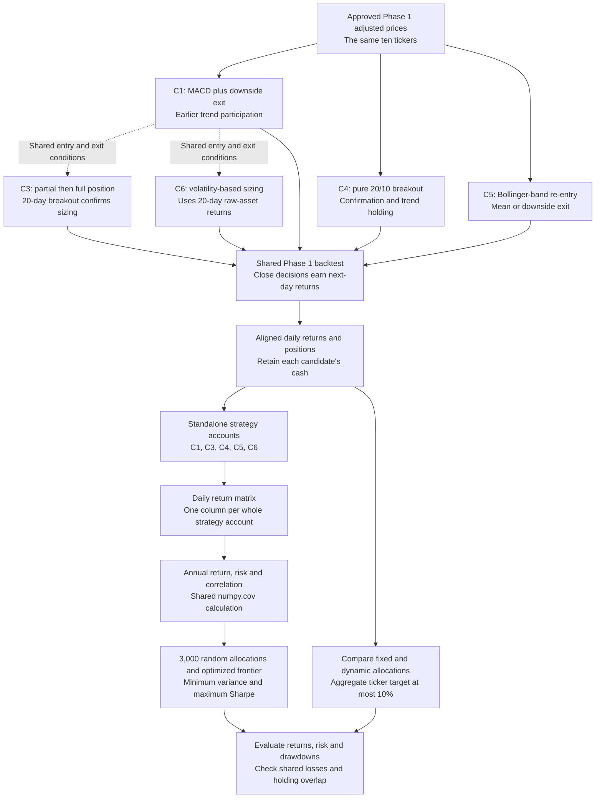
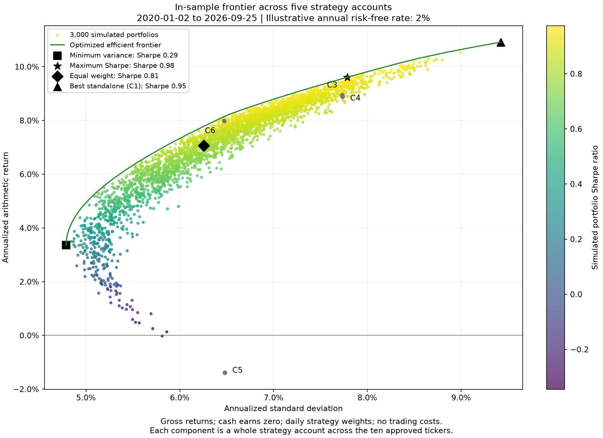
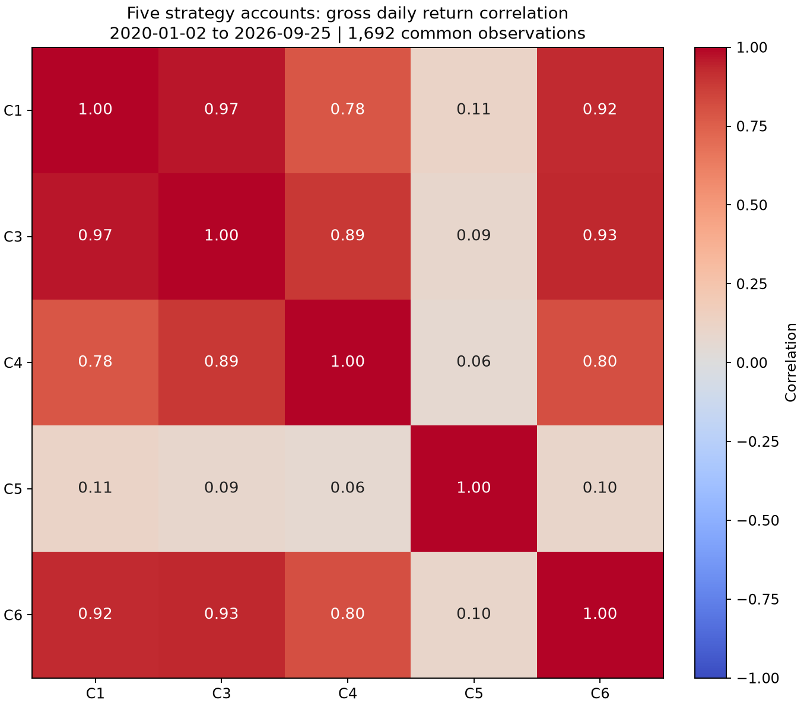

# backtesting_2_fa26_uiuc
Repository for Backtesting group 2 for Fall 2026 semester's Financial Engineering club projects.

The tickers being used for phase 1 are: SPY, QQQ, IWM, AAPL, JPM, XOM, JNJ, PG, WMT, CAT

Commit completed work to `Kevin-Mean-revision` and submit a pull request into `main`.

## Current work

This is a small, offline backtesting foundation. `run.py` handles the original phases;
`experiment.py` explicitly runs the five-candidate allocation experiment.
The command-line runner uses buy-and-hold, or raw-asset portfolios with `--phase2`.
RSI mean reversion and Huixin's strategies use the same Python workflow.
The [Phase 3 frontiers](#phase-3-strategy-frontiers) reuse these functions for
each strategy and for all 30 strategy–ticker return streams together.
The [five-strategy frontier](#efficient-frontier-across-five-strategy-portfolios)
also treats each C1/C3/C4/C5/C6 account as one investable component.
A risk-free rate must be supplied explicitly; no rate is downloaded or assumed.
Completed coding work goes to `Kevin-Mean-revision`
and then through a pull request into `main`.

The project stays in one shallow folder, with shared calculations used by every phase:

```text
run.py                  Baseline, raw-asset portfolios, and strategy comparisons
experiment.py           Combination controls, costs, allocations, and strategy frontier
data.py                 Read and validate the approved local prices
backtest.py             Apply signals to next-day returns and build equity curves
performance.py          Shared statistics, covariance, and portfolio optimization
allocation.py           Cash, trading fees, and monthly capital allocations
strategies.py           Huixin's Golden Cross and momentum rules
mean_reversion.py       Independent RSI strategy
combinations.py         C1, C3, C4, C5, and C6 signals
plots.py                Equity curves, correlation heatmap, and efficient frontier
tests/
    conftest.py         Shared approved-data setup
    test_core.py        Data, timing, strategies, metrics, and frontier checks
    test_combinations.py  Combination signals and holding states
    test_allocation.py  Trading costs, cash, rankings, and capital drift
docs/                   PNGs displayed in this README
```

`performance.py` contains the functions previously in `metrics.py` and
`portfolio.py`; import `summarize`, `excess_returns`, and `analyze_portfolios`
from `performance`. The comparison function is now `run.compare` instead of
`compare.compare`. Both existing command-line entry points remain available.

The current total is **929 lines**, including all source, tests, comments, and
blank lines. Preserve all functionality and test coverage while keeping the code
readable; the established 950-line ceiling remains. Phase 2 retains its
300-added-line limit, with the same calculations now in `performance.py`.
The earlier mean-reversion addition retains its separate 100-added-line limit.
All charts and their interpretations are presented in this README. The `docs/`
folder contains supporting PNG images only; there is no separate visual report.

## Run the current baseline

From the repository folder, use a Python environment with the libraries in
`requirements.txt` installed. For the existing local environment and dataset:

```sh
.venv/bin/python -B run.py data
```

The data-folder argument is required; replace `data` with the path to your approved
dataset when needed. The command prints a table of buy-and-hold results. It does
not create result files. Use `--help` for the options. An explicit annual decimal
rate can be supplied with `--risk-free`; otherwise Sharpe remains unavailable.

## Run RSI mean reversion

From the repository folder, explicitly select this strategy using the same local data:

```sh
.venv/bin/python -B - <<'PY'
from mean_reversion import mean_reversion
from run import analyze
result = analyze("data", strategy=mean_reversion)
print(result["summary"].to_string())
print(result["benchmark_summary"].to_string())
PY
```

### How to read the strategy

`mean_reversion` keeps three steps together: check the settings, prepare daily
gains and losses, then update RSI and each ticker's position one day at a time.
It takes a price table, with dates in rows and tickers in columns, and returns
a decision table with the same layout. `1.0` means invested, `0.0` means cash,
and `NaN` means there is not enough history to make a decision yet.

RSI (Relative Strength Index) compares recent gains with losses. The default
uses 14 daily price changes, so the first value needs 15 price observations.
Wilder's smoothing starts with the average of those gains and losses; afterward,
each average becomes (13 times its previous value + today's gain or loss) / 14.
Losses are measured as positive amounts. RSI is 100 times the average gain divided
by the sum of the average gain and average loss. All gains gives RSI 100 and all
losses gives 0. When both smoothed averages are zero, this implementation uses
neutral RSI 50; a single flat day does not reset an existing RSI to 50.

| RSI after warm-up | Decision for each ticker |
|---|---|
| Below 30 | Buy if currently in cash; otherwise remain invested |
| From 30 up to, but not including, 50 | Keep the current position: invested or cash |
| 50 or higher | Sell if invested; otherwise remain in cash |

The mean-reversion idea is to test whether a rebound follows recent weakness.
This is a hypothesis, not a guarantee that a low-RSI asset will recover. Holdings
are tracked separately for each ticker; these are not weights in a combined portfolio.

Decisions are made at the close. The shared backtest applies each decision to the
following close-to-close return, so today's price is not used to choose today's
position. With the default period, the first 14 decision rows stay missing;
the first decision is at observation 15 and evaluation starts at observation 16.
The benchmark uses those same evaluation dates. At least 17 price observations
are needed for the backtest's minimum of two evaluation returns.

The function only calculates signals from its input; it does not download, change,
or save data. It does not depend on Huixin's strategy file. Both strategies can
use the shared backtest and metrics independently. Costs and cash interest remain
zero. Without an explicit risk-free input, Sharpe stays unavailable.

## How the phases connect

`analyze(data_folder, strategy=None, risk_free=None)` in `run.py` is the shared
workflow. It returns an ordinary dictionary of tables, so later phases can reuse
the same objects without saving or reloading intermediate files.

| Result | What it contains |
|---|---|
| `prices` | Complete validated history, including dates needed for warm-up |
| `held_positions` | Prior-day decisions applied to the evaluation dates |
| `asset_returns` | Raw buy-and-hold asset returns over the evaluation dates |
| `strategy_returns` | Returns earned by the supplied signals, on matching dates |
| `benchmark_returns` | A separate copy of the matching buy-and-hold returns |
| `equity`, `benchmark_equity` | Growth from one, including the initial close |
| `summary`, `benchmark_summary` | Matching performance-statistic tables |
| `benchmark_only` | True when no strategy function was supplied |

Each strategy function takes `prices` and returns a signal
table with the same dates and columns. Passing that function to `analyze` uses the
existing backtest and metrics. Without it, both return tables contain the baseline;
`benchmark_only=True` means no selected strategy has been evaluated.

Phase 2 passes the baseline's `asset_returns` to `analyze_portfolios` in
`performance.py`. Do not pass a strategy backtest's shortened warm-up window when
you intend to use the full raw-asset history. Phase 3 instead supplies aligned
`strategy_returns`, with each column named by strategy and ticker. The optimizer's
internal comparison is one of those streams; raw SPY is compared separately.
Both phases can use `summarize` with portfolio names as columns and `equity_curve`
for growth calculations. The matched evaluation dates make comparisons fair;
`prices` retains the full history when an explicitly different period is required.

The Phase 3 analysis below uses the existing Python functions. The CLI's
`--phase2` option continues to analyze raw assets. A benchmark-only result does
not contain a selected strategy's returns.

## Run Phase 2

### Sharpe ratio graph


Updated on October 24, 2026 using the approved January 5, 2010–September 25, 2026
return sample and an illustrative 2% annual risk-free rate. Point colors show
simulated portfolio Sharpe ratios; black markers identify the four comparisons.
The axes show risk and return, not Sharpe. This is a saved snapshot, updated only
on request, not a live chart.

The maximum estimated Sharpe is **1.073**, compared with **0.898** for equal
weights and **0.747** for SPY. These are historical estimates, not forecasts or
a universal ceiling. The graph correction does not improve investment returns.

| Portfolio | Arithmetic return/year | Volatility/year | Sharpe |
|---|---:|---:|---:|
| Minimum variance | 12.84% | 13.57% | 0.801 |
| Maximum Sharpe | 20.36% | 17.13% | 1.073 |
| Equal weight | 16.55% | 16.22% | 0.898 |
| SPY | 14.72% | 17.05% | 0.747 |

Equal weight holds 10% in each asset; SPY is the single-index comparison.
Each dot is one of 3,000 allocations; its color measures Sharpe. The green line
comes from constrained optimization, not from joining the best random dots.
It traces the upper frontier, starting at the minimum-variance portfolio.
Within this mean–variance model, a risk-averse investor prefers the frontier:
least variance for a target return, or highest return for a given risk. The chosen
point depends on risk tolerance. Maximum Sharpe does not mean minimum risk.
See [CFA Institute's portfolio risk and return explanation](https://www.cfainstitute.org/insights/professional-learning/refresher-readings/2026/portfolio-risk-return-part-1).

### Correlation and diversification


The heatmap uses the same **4,207 daily returns** as the frontier. Correlation
near 1 means returns tend to move together. The checks below exclude self-pairs
and count each distinct pair once; "least" means the smallest signed value.

| Correlation check | Result |
|---|---:|
| Highest pair: SPY / QQQ | 0.930 |
| Second-highest pair: SPY / IWM | 0.882 |
| Lowest pair: XOM / WMT | 0.213 |
| Median of the 45 distinct pairs | 0.390 |
| Pairs above 0.80 | 2 / 45 |
| Negative pairs | 0 / 45 |

The 0.80 level is a descriptive flag, not an exclusion rule. Shared U.S. equity
exposure may explain the highly correlated ETF pairs; different business drivers
may help explain XOM/WMT. These are interpretations, not causal findings, and
correlations can change with the period.

Lower correlations help all else equal; negative correlation is not required.
Returns, individual volatilities, and weights also determine portfolio risk.
For the maximum-Sharpe weights, the weighted average individual volatility is
23.89%, while portfolio volatility is 17.13%. Their ratio is **1.395**.
The former is the hypothetical volatility if every pair had correlation +1,
with weights and individual volatilities unchanged. This is a mathematical
comparison, not another observed portfolio or a forecast.

Perfectly positively correlated assets offer no correlation-based diversification
benefit. They can still be held together: identical return streams can share a
weight without changing portfolio results. Lower volatility also does not
guarantee smaller drawdowns or better future returns.

### Why 1.07 is not just an ETF-overlap problem

| Asset | Maximum-Sharpe weight |
|---|---:|
| AAPL | 36.29% |
| JNJ | 23.36% |
| WMT | 23.32% |
| CAT | 15.81% |
| JPM | 1.06% |
| QQQ | 0.17% |
| SPY | 0.00% |
| IWM | 0.00% |
| XOM | 0.00% |
| PG | 0.00% |

Weights are rounded; tiny numerical residuals appear as zero. The optimizer
already assigns almost no weight to the index ETFs. The top three allocations
total **82.96%**, so the portfolio remains concentrated.

Because zero weights are allowed, removing an asset cannot increase the
theoretical best in-sample Sharpe: it only narrows the available choices.
The maximum depends on estimated returns and covariances, the sample, the
risk-free input, and the long-only constraints. A matched comparison is more
informative than calling 1.07 "good" or "not great" on its own.

### Proposed basket for review

**Proposal only: no tickers changed, new prices downloaded, or candidate results
calculated.** Keep ten assets and the SPY benchmark. Retain SPY and the seven
individual stocks; replace QQQ and IWM with two different asset exposures:

| Proposed change | Reason to test it | Limitation |
|---|---|---|
| QQQ → IEF | Add U.S. Treasury bonds with 7–10 years to maturity | Bond prices can fall when yields rise; lower equity correlation must be measured |
| IWM → IAU | Add exposure to physical gold through a gold trust | Gold can be volatile; negative equity correlation is not assumed |

These exposure descriptions come from [iShares IEF](https://www.ishares.com/us/products/239456/ishares-7-10-year-treasury-bond-etf)
and [iShares IAU](https://www.ishares.com/us/products/239561/ishares-gold-trust).
The diversification benefit is a hypothesis to test, not a result supplied by
those sources. Both products launched before 2010; complete approved price
coverage still needs checking.

Proposed order: **SPY, IEF, IAU, AAPL, JPM, XOM, JNJ, PG, WMT, CAT**.
This changes the original equity-only universe and removes QQQ/IWM exposures.
Replacing assets does not guarantee a higher Sharpe. The proposal aims to test
different return drivers, rather than selecting assets to force a higher result.

After approval of the basket and its data, compare it with the original basket
using the same dates, 2% illustrative rate, 252-day annualization, and long-only
weights. Reuse the Phase 1 cleaning and return definitions; keep the original
approved dataset intact. Check complete aligned observations and weights summing
to one within `1e-8`. Report changes in maximum Sharpe, minimum volatility,
volatility at matched feasible returns, pair correlations, and the largest weight.
Keep equal-weight and SPY comparisons, and report deterioration as well as gains.
Any data acquisition or saved output needs an explicit request; this proposal
does not add a download or export step to the code.

### Run the analysis

Use the same environment and approved data folder. This command explicitly asks
for calculations and two chart windows; it does not save them:

```sh
.venv/bin/python -B run.py data --phase2 --risk-free 0.02
```

Here, `0.02` is the user-approved 2% illustration, not an observed Treasury or SOFR
rate. Replace it only when a different rate is selected. A historical-period average Treasury
yield can be used as a constant proxy, but must be obtained and selected explicitly.
Phase 2 rejects a missing rate. It supports a constant rate so the optimizer's
Sharpe definition matches Phase 1; it does not accept a time-varying rate series.

The runner first calls the existing baseline, then passes its raw-asset returns
to `analyze_portfolios`. There are no strategy signals or warm-up losses in this
Phase 2 sample. Every asset and comparison uses exactly the same dates.

| Returned table | Rows and columns |
|---|---|
| `asset_summary` | Ten assets × existing metrics plus `expected_return` |
| `correlation`, `covariance` | Ten assets × ten assets, in the original ticker order |
| `correlation_pairs` | Least and most correlated distinct pairs, in that order |
| `simulation_weights`, `simulation` | 3,000 portfolios × asset weights or three statistics |
| `frontier_weights`, `frontier` | 40 optimized points × weights or statistics |
| `comparison_weights`, `comparison` | Four named portfolios × weights or statistics |
| `comparison_returns` | Original return dates × four named portfolios |
| `comparison_summary` | Four portfolios × existing metrics plus `expected_return` |

The three statistics are arithmetic expected return, annualized volatility, and
Sharpe. `period` and `risk_free` keep the dates and rate input with the result.
Weights are nonnegative and sum to one. The random seed is 42, so rerunning the
same inputs produces the same 3,000 simulated allocations. These are alternative
weights applied to existing returns, not generated market observations.

### Calculations and limits

Expected return is the daily arithmetic mean multiplied by 252. The existing
`annualized_return` remains CAGR (compounded annual growth); it is reported in
the summary but is not used as the frontier's vertical coordinate.
`numpy.cov(..., rowvar=False, ddof=1) * 252` estimates annual sample covariance:
columns represent assets and off-diagonal entries describe their joint movement.
Portfolio variance is `weights @ covariance @ weights`; its square root is volatility.
See [NumPy's covariance documentation](https://numpy.org/doc/stable/reference/generated/numpy.cov.html).

The same Phase 1 risk-free conversion is used throughout: a constant annual rate
becomes `(1 + rate) ** (1 / 252) - 1` per trading day. Sharpe is the annualized daily
excess mean divided by annualized volatility. With a constant rate, excess-return
volatility equals raw-return volatility. No cash interest is added to strategies.
The optimizer requires positive portfolio risk and at least one positive expected
excess return; otherwise it stops rather than presenting an undefined tangency.
Solver failures and constraint violations also stop the analysis. The solver uses
[SciPy SLSQP](https://docs.scipy.org/doc/scipy/reference/optimize.minimize-slsqp.html).

Fixed portfolio weights imply daily rebalancing, unlike letting initial asset
weights drift. Costs are excluded. Weights are fitted and evaluated on the same
history, so these are in-sample estimates, not an out-of-sample trading result.
The chosen stocks also represent a selected surviving universe; this exercise
does not establish how an investor would have selected them at the start of 2010.
`plot_portfolios` returns two figures in memory; only the explicitly invoked CLI
shows them. Nothing exports files or refreshes data automatically.

All numerical evidence above comes from the approved local inputs through
[run.py](run.py) and [performance.py](performance.py).
The two PNG snapshots were saved on explicit request. The
[existing-data caveats](#existing-data) also apply to every displayed result.

## Phase 3: strategy frontiers

Updated October 26, 2026. Each strategy–ticker return stream is treated as an
investable component. The first three frontiers each combine ten tickers using
one strategy; the fourth combines all **30 streams**. A weight assigns capital
to that strategy account, including its cash days. The existing trading rules
and the ten approved tickers are unchanged.

The [five combinations](#proposed-strategy-combinations) below are implemented
separately. Their account-level frontier appears in the
[new analysis](#efficient-frontier-across-five-strategy-portfolios); they are not
included in these four original strategy–ticker frontiers.

All four analyses use **3,955 daily returns, January 4, 2011–September 25, 2026**,
and the approved **2% illustrative annual risk-free rate**. Signals are calculated
from the full Phase 1 price history. Returns are aligned after the longest
warm-up; the existing backtest applies the one-day execution delay once.
Cash returns remain zero, and no missing observations are filled.

### Read the four charts

Each chart shows 3,000 simulated allocations and 40 optimized upper-frontier
points. The green line belongs to the named strategy universe. The dashed gray
line is the raw-asset frontier recalculated on the same dates; the orange X is
buy-and-hold SPY, an external comparison that receives no strategy-portfolio
allocation. All charts share their axes and Sharpe color scale.

Black markers identify minimum variance, maximum Sharpe, equal weights, and the
single stream with the highest estimated Sharpe in that universe. "Best" is
selected using this same historical sample, not information available in 2011.
Annual returns below are arithmetic means multiplied by 252, not CAGR.

| Maximum-Sharpe portfolio | Annual return | Annual volatility | Sharpe |
|---|---:|---:|---:|
| Golden Cross: ten streams | 14.63% | 14.29% | 0.885 |
| Momentum: ten streams | 14.31% | 14.70% | 0.839 |
| RSI mean reversion: ten streams | 4.31% | 6.55% | 0.355 |
| Combined: 30 streams | 14.73% | 13.84% | **0.921** |
| Raw assets: matching dates | 19.20% | 16.31% | **1.056** |
| Buy-and-hold SPY: matching dates | 14.70% | 17.00% | 0.748 |

The original Phase 2 maximum of 1.073 uses a longer sample. **1.056 is the
appropriate raw-asset comparison here.** Combining strategies improves the
estimated maximum over each strategy alone, but does not beat the matched-date
raw-asset maximum. These estimates do not establish future outperformance.

| Universe | Minimum volatility | Minimum-variance Sharpe | Equal-weight Sharpe | Best single stream: Sharpe |
|---|---:|---:|---:|---|
| Golden Cross | 10.35% | 0.490 | 0.693 | Golden Cross QQQ: 0.782 |
| Momentum | 11.05% | 0.480 | 0.694 | Momentum QQQ: 0.742 |
| RSI mean reversion | 5.64% | 0.230 | 0.209 | RSI PG: 0.292 |
| Combined | 5.55% | 0.277 | 0.621 | Golden Cross QQQ: 0.782 |

### Golden Cross frontier


This combines the existing 50/200-day trend rule across tickers. Its maximum
Sharpe exceeds the best single stream's 0.782 and equal weights' 0.693 in this
sample. The maximum-Sharpe allocation uses five tickers; it is still exposed
to shared equity trends and delayed exits after reversals.

### Momentum frontier


This uses each ticker's positive return from 252 sessions ago to 21 sessions
ago. It does not rank assets to select relative winners. Its maximum Sharpe is
below Golden Cross on these dates. These two trend rules can hold the same
underlying stocks at the same time, so their names alone do not imply independence.

### RSI mean-reversion frontier


This uses 14-day RSI, entering below 30 and exiting at or above 50. The fitted
portfolio has low volatility and low return. Its maximum-Sharpe weights average
only **9.79% invested in equities** across days; the remainder is zero-interest
cash inside the strategy accounts. Low volatility therefore should not be read
as evidence of better diversification by itself. For comparison, the corresponding
equity exposure is 78.30% for Golden Cross and 83.58% for momentum.

### Combined strategy frontier


All 30 streams are eligible, with nonnegative weights summing to one. Zero
weights let the combined universe reproduce any separate strategy portfolio,
so its theoretical best in-sample Sharpe cannot be lower. The fitted maximum
uses six streams: about **69.81% Golden Cross and 30.19% momentum**. RSI receives
zero weight at this particular maximum-Sharpe point; that does not exclude it
from lower-risk points on the frontier or prove it will be unhelpful in another
period. The combined minimum volatility is 5.55%.

### Maximum-Sharpe allocations

For the separate frontiers, each percentage is capital allocated to that
strategy on the named ticker. Zeros include tiny solver residuals; rounding
may prevent displayed weights from totaling exactly 100%.

| Ticker | Golden Cross | Momentum | RSI mean reversion |
|---|---:|---:|---:|
| SPY | 0.00% | 0.00% | 0.00% |
| QQQ | 34.29% | 37.72% | 8.67% |
| IWM | 0.00% | 0.00% | 0.00% |
| AAPL | 26.30% | 10.63% | 4.85% |
| JPM | 11.36% | 6.13% | 13.96% |
| XOM | 14.19% | 3.73% | 0.00% |
| JNJ | 0.00% | 0.00% | 0.00% |
| PG | 0.00% | 0.00% | 41.12% |
| WMT | 13.87% | 31.26% | 29.72% |
| CAT | 0.00% | 10.52% | 1.68% |

| Combined stream | Weight |
|---|---:|
| Golden Cross: QQQ | 26.99% |
| Golden Cross: AAPL | 23.53% |
| Golden Cross: JPM | 8.14% |
| Golden Cross: XOM | 11.14% |
| Momentum: WMT | 23.92% |
| Momentum: CAT | 6.27% |
| Other 24 streams | 0.00% |

### Shared data and reproduction

The saved analysis uses the existing functions; no second backtest or portfolio
engine was added. Follow these steps with the approved local dataset:

1. Load full prices with `data.load_prices`. For each of `golden_cross`,
   `momentum`, and `mean_reversion`, pass its signals to `backtest` and keep
   `strategy_returns`.
2. Give columns unique strategy/ticker names. Join the three tables on their
   common dates, preserving cash zeros. Here the separate tables are 3,955 × 10
   and the combined table is 3,955 × 30. Do not shift these returns again.
3. For each table, use `summarize(table, 0.02)` to identify its highest-Sharpe
   single column. Pass that column's name as `benchmark` to
   `analyze_portfolios(table, 0.02, benchmark=...)`. This internal comparison is
   a strategy stream, not raw SPY. The function returns simulations, the frontier,
   comparison metrics, and their full allocation tables in memory.
4. Recalculate raw-asset returns on those same dates for the gray reference
   frontier and raw-SPY comparison. Keep them outside the strategy input table.
5. Call `plot_portfolios(result, label=...)` with the strategy name. It returns
   figures without saving. These four PNGs were explicitly exported for this
   request; the export also adds the external references and common scales.

The same `numpy.cov(..., rowvar=False, ddof=1) * 252` and risk-free conversion
apply in every case. Portfolio weights are fixed targets rebalanced daily;
the underlying strategy positions still switch between invested and cash.
Costs and slippage are excluded. This is a static, in-sample frontier analysis;
it does not implement dynamic portfolio weights or mix raw assets into the
strategy portfolios. The proposed IEF/IAU substitutions remain unimplemented.

Checks: all frontier weights sum to one and meet their target returns within
`1e-8`; comparison metrics agree with directly weighted daily returns. An
independent convex reformulation reproduced each maximum Sharpe within `1e-8`.
These checks validate the calculations, not future performance. The existing
data-quality and selected-universe limitations below still apply.

### Proposed strategy combinations

These five research candidates aim for quicker participation in rebounds and
quicker exposure reduction during declines, with acceptable risk after costs.
All use the same ten approved tickers. Each ticker's target is at most **10% of
total portfolio equity** across all strategy accounts; unused budgets stay in cash.
Positions are long-only, with no leverage, and decisions take effect on the
following day's return, as in Phase 1. None of these candidates changes the
existing Golden Cross, momentum, or RSI rules.

#### Indicators

- **MACD** is the 12-day minus the 26-day exponential moving average
  (`adjust=False`); its signal line is a 9-day exponential average of MACD.
  "Bullish" means MACD is above the signal line.
- **Channels** use the highest adjusted close of the previous 20 trading days and
  the lowest of the previous 10, both excluding today's close (a closing-price
  variation of Donchian channels).
- **Bollinger bands** use the 20-day mean plus or minus two population standard
  deviations (`ddof=0`). All new signals wait until day 34.

#### The five candidates

| Candidate | Rule (per ticker, 10% budget) | Role | Main limitation |
|---|---|---|---|
| C1 | Hold while MACD is bullish and the close is at or above the previous 10-day low | Earlier trend participation | False recoveries and repeated trades in sideways markets |
| C3 | C1's conditions, but enter at 5%; increase to 10% after the close exceeds the previous 20-day high | Smaller position before confirmation | Misses part of early rebound gains |
| C4 | Enter when the close exceeds the previous 20-day high; exit when it falls below the previous 10-day low | Confirmed breakout that holds through MACD weakness | Late entry and false breakouts |
| C5 | Enter when the close re-enters the lower Bollinger band, rises, stays below the mean and above the 10-day low; exit at the mean or below the 10-day low | Rebound entry before MACD or a breakout | Failed rebounds; exiting at the mean can miss a longer advance |
| C6 | C1's conditions, sized at 10% × min(1, 20% ÷ 20-day volatility of raw-asset returns) | Risk control | Light exposure during volatile rebounds |

C1, C3, and C6 share entry and exit conditions and mainly change the amount
invested; C4 and C5 change *when* positions are taken. Five labels do not establish
five independent return sources. MACD background:
[Fidelity](https://www.fidelity.com/learning-center/trading-investing/technical-analysis/technical-indicator-guide/macd);
Bollinger bands: [Fidelity](https://www.fidelity.com/learning-center/trading-investing/technical-analysis/technical-indicator-guide/bollinger-bands);
volatility sizing: [Moreira and Muir](https://amoreira2.github.io/alan-moreira.github.io/VolPortfolios_published.pdf).

#### Relationship map

Solid arrows show data or calculation flow; dotted arrows show shared trading
conditions. C3 and C6 are parallel sizing alternatives, not sequential steps.



| Market situation | Potential contribution |
|---|---|
| Early rebound before bullish MACD | C5 may participate while C1 and C4 remain in cash |
| Sustained advance following a rebound | C1 and C4 may hold after C5 exits at the mean |
| Temporary MACD weakness without a downside breakdown | C4 may hold while C1 exits |
| Failed early entry | C3's smaller initial position and C6's scaling may reduce the amount lost |
| Continued decline below the shared exit threshold | Several candidates may exit together; common downside exposure remains |

#### Fixed and dynamic weighting

Both versions rebalance among the five accounts on the last trading day of each
month; weights drift between rebalances, and each account keeps trading its own
signals.

| Version | Target allocation among C1, C3, C4, C5, and C6 |
|---|---|
| Fixed targets | 20% to each candidate at every monthly rebalance |
| Dynamic targets | 30%, 25%, 20%, 15%, and 10%, from highest to lowest ranked |

The dynamic version ranks candidates by their compounded net returns over the
previous **63 common trading days** (ties share weights; equal fifths until 63
days exist). The lookback and weights are illustrative, not optimized.

#### Running and testing

Run the experiment explicitly; it prints results and saves nothing. Repeat with
`--cost-bps 0` or `--cost-bps 10` for cost sensitivity.

```sh
.venv/bin/python -B experiment.py data --cost-bps 5 --risk-free 0.02
MPLBACKEND=Agg BACKTEST_DATA=data .venv/bin/python -B -m pytest -p no:cacheprovider -q
```

Method notes:

- The comparison starts after the first 252 price observations, matching Phase 3.
  Results cover **January 2, 2020–September 25, 2026**; 2011–2019 only sets the
  exposure-matched C1 scale (the fixed blend's average invested fraction divided
  by C1's, capped at one). This is not an untouched holdout.
- Costs of 0, 5, and 10 basis points per purchase or sale are illustrative. They
  cover signal trades, price drift, and allocation transfers; offsetting trades
  across accounts are not netted. Cash earns zero.
- Controls: equal-weight assets rebalanced daily (not passive buy-and-hold) and the
  Phase 1 blend, which averages the Golden Cross, momentum, and RSI signals.
- Overlap compares long/cash switching dates with C1 (intersection over union);
  stress days are days when the equal-weight basket moves more than 1%.

**Measured results** (5 basis points one-way cost; 2% illustrative risk-free rate;
annual return is compound growth, Sharpe uses daily excess returns):

| Candidate or control | Annual return | Annual volatility | Sharpe | Maximum drawdown | Mean invested fraction |
|---|---:|---:|---:|---:|---:|
| C1 | 9.79% | 9.42% | 0.828 | -8.85% | 49.73% |
| C3 | 7.98% | 7.73% | 0.776 | -6.63% | 42.67% |
| C4 | 8.26% | 7.73% | 0.809 | -6.63% | 46.21% |
| C5 | -2.15% | 6.50% | -0.607 | -24.44% | 8.43% |
| C6 | 6.98% | 6.47% | 0.769 | -6.66% | 41.83% |
| Five-candidate fixed blend | 6.19% | 6.25% | 0.676 | -8.86% | 37.82% |
| Five-candidate dynamic blend | 6.15% | 6.76% | 0.624 | -9.30% | 39.97% |
| Exposure-matched C1 | 7.69% | 7.40% | 0.771 | -6.99% | 39.06% |
| Equal-weight assets, rebalanced daily | 19.42% | 18.46% | 0.947 | -31.68% | 100.00% |
| Equal-signal Phase 1 blend | 9.04% | 12.02% | 0.616 | -24.99% | 54.56% |

The exposure control scales C1 to **78.54%** of its normal targets. The fixed blend
has lower volatility than this control but lower return and a deeper drawdown, so
its lower risk is partly just more cash. C5 has a low correlation with C1
(**0.111**) but loses money even before costs.

| Fixed blend variant | Annual return | Sharpe | Maximum drawdown |
|---|---:|---:|---:|
| All five | 6.19% | 0.676 | -8.86% |
| Remove C1 | 5.29% | 0.594 | -9.12% |
| Remove C3 | 5.75% | 0.636 | -9.57% |
| Remove C4 | 5.67% | 0.603 | -9.71% |
| Remove C5 | 8.28% | 0.834 | -5.85% |
| Remove C6 | 5.99% | 0.638 | -10.14% |

Removing C5 improves return, Sharpe, and drawdown (average invested fraction rises
to **45.12%**); removing C6 worsens all three. These are diagnostics on the same
history, not a validated selection rule.

| One-way cost assumption | Fixed annual return / Sharpe | Dynamic annual return / Sharpe | Without C5 annual return |
|---|---:|---:|---:|
| 0 basis points | 7.12% / 0.815 | 7.35% / 0.791 | 9.30% |
| 5 basis points | 6.19% / 0.676 | 6.15% / 0.624 | 8.28% |
| 10 basis points | 5.28% / 0.537 | 4.83% / 0.434 | 7.26% |

Dynamic weighting does not show a robust improvement, and the gap widens with
costs. Annual traded notional is about **18.78×** portfolio value for dynamic
weighting versus **17.35×** for fixed.

| Candidate | Entry/exit overlap with C1 | Average daily return on C1's worst 10% of days | Fraction losing on those days |
|---|---:|---:|---:|
| C1 | 100.00% | -0.98% | 100.00% |
| C3 | 100.00% | -0.81% | 100.00% |
| C4 | 12.16% | -0.71% | 94.12% |
| C5 | 3.30% | -0.08% | 34.71% |
| C6 | 100.00% | -0.69% | 100.00% |

C3 and C6 (correlations with C1 of **0.968** and **0.924**) shrink losses on bad days
but still lose alongside C1. C4 trades on different dates yet still loses on most of
C1's worst days. C5 separates most, but its negative return shows low correlation
alone is not enough. On days the raw basket rises or falls more than 1% (average
**1.79%** / **-1.91%**), the fixed blend returns **0.51%** / **-0.56%** and the dynamic
blend **0.53%** / **-0.59%**: less downside, but much of the upside is missed too.
The fixed blend averages **6.73 active tickers** and **5.83 effective tickers**
(dynamic: **5.70**).

Validation on October 26, 2026: **38 tests passed**, covering warm-up, state
retention, entries and exits, volatility sizing, fees, cash, monthly ranking, ties,
and allocation drift. No dataset was downloaded, refreshed, or saved.

### Efficient frontier across five strategy portfolios

Updated October 26, 2026. This extends the flow map by treating **C1, C3,
C4, C5, and C6 as five investable accounts**. Each account already trades
the ten approved tickers. A 40% allocation to C1 funds that entire account,
including its cash; it does not invest 40% in one stock or apply MACD to a
strategy equity curve. All five remain eligible for optimization.

The input is **1,692 aligned daily returns, January 2, 2020–September 25, 2026**,
with the same **2% illustrative annual risk-free rate**. The main chart excludes
costs, matching the original frontier convention. Weights are nonnegative, sum
to one, and rebalance daily. The optimizer fits this same historical sample;
these are not weights known in 2020 or a test of future performance.



The 3,000 dots are allocations across the five accounts. The green line traces
40 optimized upper-frontier points. The star improves estimated Sharpe from
**0.948 for C1 alone to 0.980**, with lower annual return and lower volatility.
Annual return in this table and on the graph is the arithmetic daily mean times
252; the maximum-Sharpe portfolio's separate CAGR is **9.75%**.

| Gross portfolio | Annual arithmetic return | Annual volatility | Sharpe | Maximum drawdown |
|---|---:|---:|---:|---:|
| Minimum variance | 3.36% | 4.79% | 0.288 | -13.84% |
| Maximum Sharpe | 9.61% | 7.79% | **0.980** | -6.15% |
| Equal weights, rebalanced daily | 7.07% | 6.25% | 0.813 | -8.86% |
| Best standalone account: C1 | 10.91% | 9.42% | 0.948 | -8.61% |
| Fixed weights, rebalanced monthly | 7.07% | 6.25% | 0.815 | -8.67% |
| Dynamic weights, rebalanced monthly | 7.32% | 6.76% | 0.791 | -8.20% |
| Phase 1 equal-signal blend | 9.60% | 12.02% | 0.633 | -24.95% |

| Gross allocation | C1 | C3 | C4 | C5 | C6 |
|---|---:|---:|---:|---:|---:|
| Maximum Sharpe | 44.30% | 0.00% | 36.37% | 0.00% | 19.33% |
| Minimum variance | 0.00% | 0.00% | 5.75% | 49.88% | 44.37% |
| Equal weights | 20.00% | 20.00% | 20.00% | 20.00% | 20.00% |

Minimum variance minimizes daily fluctuation, not drawdown or lost purchasing
power. It gives roughly half its budget to C5, which has a negative standalone
return, and suffers a larger drawdown than the maximum-Sharpe allocation.
C5's low correlation can reduce volatility without making it an attractive
return contributor. Zero weights at the maximum do not remove C3 or C5 from
other frontier points or establish that they will be unhelpful in another period.

The maximum-Sharpe allocation averages **46.92% invested**, **5.99 active tickers**,
and **5.54 effective holdings**. Its lower volatility partly reflects cash.
Each ticker's aggregate target stays at or below 10%; ETF overlap still remains.
The earlier monthly fixed and dynamic rules have gross Sharpe ratios of **0.815**
and **0.791**, respectively. Their weights drift between monthly rebalances;
they are different allocation rules from this daily-rebalanced frontier.
The Phase 1 blend uses the existing equal-signal rule. These predefined rules
also differ from selecting optimized weights using the complete evaluation sample.

#### Correlation between strategy accounts



C1 and C3 are the most correlated pair (**0.968**); C1 and C6 are also strongly
related (**0.924**). They share entry and exit conditions. C4 and C5 are the least
correlated pair (**0.064**). Five strategy names do not establish five independent
return sources: C5 still loses money before costs, while C4 offers
less overlap with C1 (**0.784**) and a positive standalone return.

#### Comparison with the earlier phases

Every row below is recomputed on the **same 2020–2026 dates**, before costs.
The Phase 1 and raw-asset optimizers can select individual ticker streams;
the five-account optimizer keeps each candidate's internal ticker budgets.
These different constraints help explain the different attainable risk and return.

| Universe: maximum Sharpe unless stated | Annual arithmetic return | Annual volatility | Sharpe |
|---|---:|---:|---:|
| Five whole strategy accounts | 9.61% | 7.79% | 0.980 |
| Golden Cross: ten ticker streams | 19.65% | 14.89% | 1.187 |
| Momentum: ten ticker streams | 17.90% | 14.51% | 1.097 |
| RSI: ten ticker streams | 6.96% | 9.05% | 0.550 |
| Combined Phase 1: thirty streams | 17.56% | 12.46% | **1.251** |
| Raw assets: ten tickers | 25.01% | 19.57% | 1.177 |
| Buy-and-hold SPY | 16.46% | 20.06% | 0.722 |

The five-account mix improves on its own best constituent but does not beat the
Phase 1 combined frontier's maximum Sharpe on these dates. Its maximum operates
at a lower volatility and return. These numbers also differ from the older
2011–2026 charts because the sample changed; they are not evidence of a coding
error or a general advantage over raw assets.

#### Trading-cost sensitivity

These are separate fits after applying each assumed cost to standalone strategy
trading. **Additional costs of transferring capital between strategy accounts
are excluded**, so the positive-cost rows are not fully costed executable
portfolios. The existing monthly fixed/dynamic ledger includes those transfers
and remains the appropriate accounting workflow for those allocation rules.

| Standalone one-way cost | Maximum Sharpe | Annual arithmetic return | Annual volatility | Fitted allocation |
|---|---:|---:|---:|---|
| 0 basis points | 0.980 | 9.61% | 7.79% | C1 44.30%, C4 36.37%, C6 19.33% |
| 5 basis points | 0.867 | 9.01% | 8.11% | C1 50.02%, C4 49.98% |
| 10 basis points | 0.759 | 8.02% | 7.95% | C1 40.42%, C4 59.58% |

C6 remains in the eligible universe even when its fitted maximum-Sharpe weight
becomes zero after costs. Its benefit in the earlier equal-weight removal test
and its role in an optimized portfolio answer different questions. The change
in selected weights also shows sensitivity to cost assumptions; it is not a
validated instruction to switch allocations in live trading.

#### Data flow and reproduction

`experiment.py` reuses Phase 1 price data and next-day execution, then the existing
`allocation.py` calculates each complete strategy account's daily return.
`result["returns"]` contains candidates and controls; select only C1/C3/C4/C5/C6
for the **1,692 × 5** frontier input. Retain zero-return cash observations and any
fees charged on exit days. Do not shift these returns again or drop inactive
strategies on each date. The first three input rows before costs are shown below;
values are daily decimal returns, not percentages.

| Date | C1 | C3 | C4 | C5 | C6 |
|---|---:|---:|---:|---:|---:|
| 2020-01-02 | 0.006816 | 0.006816 | 0.008576 | 0.000000 | 0.006816 |
| 2020-01-03 | -0.006157 | -0.006157 | -0.007707 | 0.000000 | -0.006157 |
| 2020-01-06 | 0.002523 | 0.002523 | 0.002452 | 0.000000 | 0.002523 |

With `include_frontier=True`, `result["frontier"]` uses the existing
`performance.py` schema: a 5 × 5 correlation/covariance matrix, 3,000 × 5 simulated
weights, 40 × 5 frontier weights, and comparison metrics and allocations.
Covariance is still `numpy.cov(..., rowvar=False, ddof=1) * 252`; no separate
data pipeline or optimizer was added.

Use the existing Python interface for the gross chart; the CLI remains unchanged:

```python
from experiment import experiment
from plots import plot_portfolios
result = experiment("data", 0, 0.02, include_frontier=True)
frontier = result["frontier"]
figures = plot_portfolios(frontier, label="Five strategy accounts")
```

This returns figures in memory. The two PNGs above were explicitly exported for
this update. For a positive-cost result, a chart must state that standalone
costs are included and allocation-transfer costs are excluded; the generic
plot's default "no costs" footer is suitable only for the gross example above.

Validation: **38 existing tests pass**. Directly weighted daily returns reproduce
the displayed return, volatility, and Sharpe calculations. All portfolio bounds,
weight sums, and upper-frontier risk ordering pass. An independent check of all
31 possible candidate subsets reproduces the maximum Sharpe within `1e-8` at
0, 5, and 10 basis points; a separate convex formulation confirms the Phase 1
and raw-asset comparison maxima. The optional integration returns the same
results as the direct workflow. Total code is **929 lines**; approved inputs,
strategy rules, and Phase 2 calculations are unchanged.

## Existing data

Pass the existing dataset folder explicitly to `load_prices`. It must contain
`raw/daily_ohlcv.csv`, `cleaned/adjusted_close.csv`, and
`quality/quality_report.json`. The adjusted-price table uses a `date` column and
the ten ticker columns listed above, in that order.

The previously downloaded dataset contains 4,208 NYSE sessions from January 4,
2010 through September 25, 2026. Its raw checksum, cleaned adjusted prices, and
665 corporate-action records were checked for consistency. The original provider
marked 115 QQQ observations, January 4 through June 17, 2010, as repaired. This
checks internal consistency, not independent verification of Yahoo's adjustments.

Historical prices already reflect adjustments; recorded split factors must not be
applied again. The September 25 endpoint is intentional and does not trigger a
refresh. No module downloads data, fills gaps, exports results, or modifies input
files. Keep data, old results, and local environments out of commits.

## Calculation conventions

Each signal is exposure to one ticker, as a fraction of that ticker simulation's
equity. Zero is cash and one is fully invested. Signals are decided at the close
and earn the following close-to-close adjusted return. Costs and cash interest
are excluded in this foundation, including the mean-reversion evaluation.

Leading missing signals represent warm-up. Evaluation starts after every ticker
has a usable prior-day signal; later position gaps are rejected. Both equity
curves start at one on the preceding close, while metrics use actual return days.

Annualization uses 252 trading days. Annualized return is compounded growth;
volatility uses the sample standard deviation. Maximum drawdown includes the
starting investment. Win rate is the fraction of all evaluation days with positive
returns, including flat days in the denominator; it is not a completed-trade win rate.

Sharpe is left undefined unless an explicit risk-free input is supplied: either an
annual decimal rate or a Series of daily risk-free returns matching the evaluation
dates. The runner selects those dates from a supplied daily risk-free Series and
fails if a date is missing; it never fills missing rates. A constant annual rate
is converted by compounding over 252 days. Sharpe
uses daily excess returns and is undefined when their standard deviation is zero.

## Local checks

Install the libraries listed in `requirements.txt` in your Python environment.
Run the tests with the existing data folder explicitly selected:

```sh
BACKTEST_DATA=data .venv/bin/python -B -m pytest -p no:cacheprovider -q
```

Tests skip if that input is not supplied;
a skipped suite is not a verified analysis. The tests use existing market observations
and in-memory test positions, and do not create or save market data.

For a headless environment, set `MPLBACKEND=Agg` when running the tests. This
renders charts without opening windows. The Phase 2 checks cover covariance,
weight constraints, shared Sharpe/volatility definitions, SPY alignment,
reproducible simulations, chart rendering, and invalid inputs. The 2% rate in
these checks tests the formulas only; it is not a selected market assumption.
